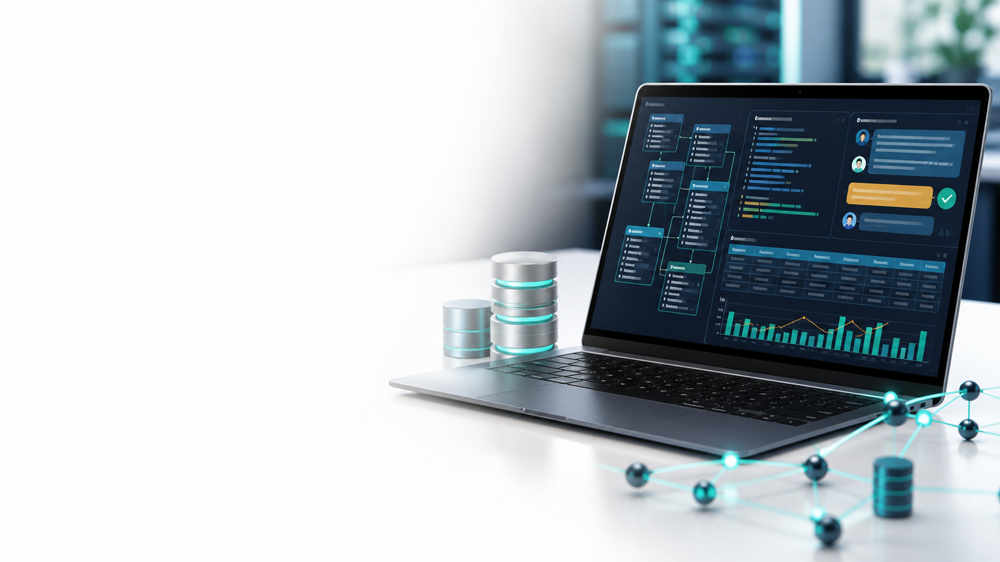

# AI Vibe Coding for SQL

Use AI assistants to model, query, transform and deliver SQLite data applications — and verify every generated query before you trust it.

| Course detail | Information |
|---|---|
| Course code | `C1154` |
| Programme | Non-WSQ |
| Duration | 1 day · 7.5 instructional hours (9:30am – 5:30pm) |
| Registration | [View course details and register](https://www.tertiarycourses.com.sg/ai-vibe-coding-for-sql.html) |
| Provider | Tertiary Infotech Academy Pte Ltd |



## About the course

This hands-on course teaches an AI-to-SQL control loop: specify the schema, rules, dialect and output contract; generate bounded SQL with an AI assistant; inspect every field, join, predicate and assumption; execute in SQLite with safe parameters and transaction boundaries; then test failures and reconcile results before approval. Every lab is a self-contained browser app backed by an in-browser SQLite database (sql.js / WebAssembly).

## Learning outcomes

- **LO1:** Apply data modelling.
- **LO2:** Apply data processing and analysis.
- **LO3:** Apply data aggregation and transformation.
- **LO4:** Perform data mapping to a data warehouse.

## Topics covered

1. **AI-Assisted SQL Data Modelling and Database Design** — requirement contracts, relational integrity, normalisation and an AI validation gate for generated DDL.
2. **SQL Data Processing, Querying and Analysis** — the logical query pipeline, safe parameter binding, join cardinality and controlled CRUD.
3. **SQL Data Aggregation and Transformation** — declaring grain, data-quality profiling, atomic transactions, CTEs, indexes and query plans.
4. **Data Mapping, Warehousing and Dashboard Development** — source-to-target mapping, star schemas, dimension-first loads and SQL-backed dashboards.

## Labs

Each folder under [`labs/`](labs/README.md) runs independently with HTML/CSS/JavaScript, schema, seed data, a prompt contract, tests and a step-by-step guide.

| # | Lab | Topic |
|---|---|---|
| 1 | [Prompt-to-Schema Design Studio](labs/lab-01-prompt-to-schema/README.md) | 1 |
| 2 | [SQLite To-Do List Web App](labs/lab-02-sqlite-todo-app/README.md) | 1 |
| 3 | [Customer and Order Relationship Lab](labs/lab-03-customer-order-model/README.md) | 1 |
| 4 | [Inventory CRUD Web App](labs/lab-04-inventory-crud-app/README.md) | 2 |
| 5 | [Order Query and Filter Explorer](labs/lab-05-order-query-explorer/README.md) | 2 |
| 6 | [Service Desk Join Lab](labs/lab-06-service-desk-joins/README.md) | 2 |
| 7 | [Sales Aggregation Dashboard](labs/lab-07-sales-aggregation-dashboard/README.md) | 3 |
| 8 | [Data Quality and Transaction Control](labs/lab-08-data-quality-transactions/README.md) | 3 |
| 9 | [CTEs, Indexes and Query Plans](labs/lab-09-ctes-index-query-plan/README.md) | 3 |
| 10 | [Warehouse Star Schema Dashboard](labs/lab-10-warehouse-star-schema/README.md) | 4 |
| 11 | [Capstone: AI-Built Service Operations App](labs/lab-11-capstone-service-ops/README.md) | 4 |

Run a lab locally (serve the folder — do not open `index.html` directly):

```bash
cd labs
python3 -m http.server 8000
# then open http://localhost:8000/lab-02-sqlite-todo-app/
```

## Courseware

| Artifact | Editable | PDF |
|---|---|---|
| Slide deck | [AI Vibe Coding for SQL-v1.0.pptx](courseware/AI%20Vibe%20Coding%20for%20SQL-v1.0.pptx) | [PDF](courseware/AI%20Vibe%20Coding%20for%20SQL-v1.0.pdf) |
| Learner Guide | [LG-AI Vibe Coding for SQL.docx](courseware/LG-AI%20Vibe%20Coding%20for%20SQL.docx) | [PDF](courseware/LG-AI%20Vibe%20Coding%20for%20SQL.pdf) |
| Lesson Plan | [LP-AI Vibe Coding for SQL.docx](courseware/LP-AI%20Vibe%20Coding%20for%20SQL.docx) | [PDF](courseware/LP-AI%20Vibe%20Coding%20for%20SQL.pdf) |
| Learner Guide (Markdown) | [LG-AI Vibe Coding for SQL.md](LG-AI%20Vibe%20Coding%20for%20SQL.md) | — |

## Distribution

This repository is the public courseware package for the course: slides, Learner Guide, Lesson Plan and labs. Use only the fictional lab data supplied; do not load real personal or company data into the labs.

## Provider

© 2026 [Tertiary Infotech Academy Pte Ltd](https://www.tertiarycourses.com.sg/). All rights reserved.
